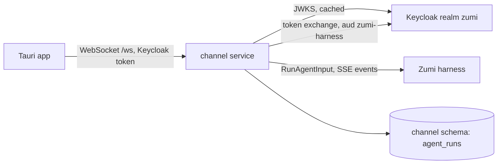
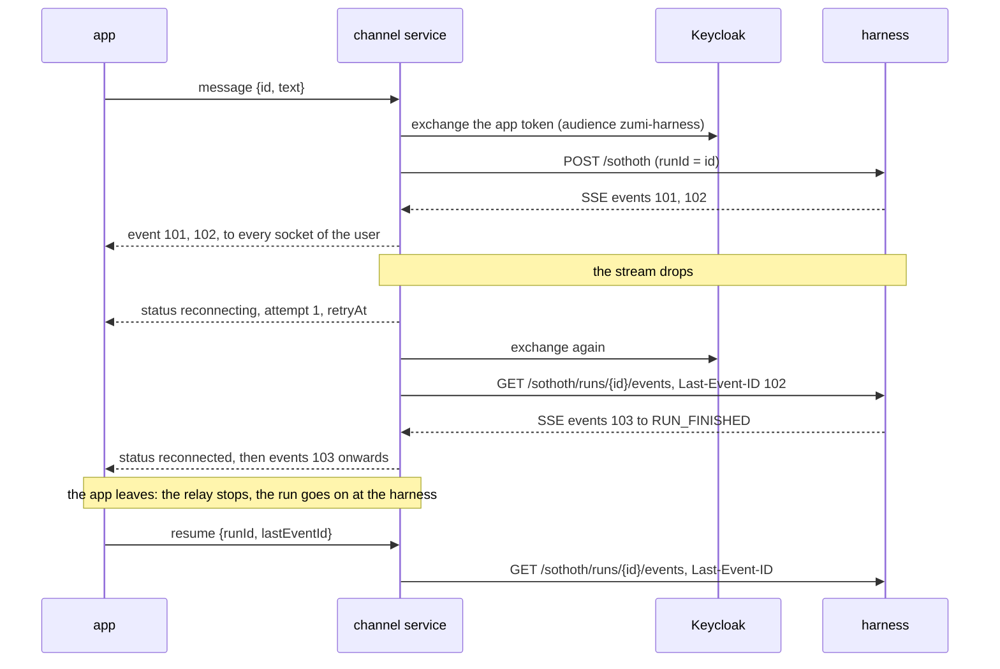

# Channel service architecture

The channel service is the only service Zumi's apps talk to. Each app holds one WebSocket to it. The service checks the app's Keycloak token, starts runs on the Zumi harness with a token exchanged for the harness, and relays every AG-UI event of a user's runs to every socket that user has open. Read this page before you change how the service is put together. Follow [the coding guidelines](../development/coding-guidelines.md) for the code itself, and [running the channel service](../development/running.md) to start it.

## Packages

| Package                    | Holds                                                                                              |
| -------------------------- | -------------------------------------------------------------------------------------------------- |
| `cmd/channel-service`      | The binary: loads the config, wires the packages, serves `/health` and `/ws`, runs migrations      |
| `internal/config`          | `Config`, read from `config.toml`, then `.env`, then the environment                               |
| `internal/telemetry`       | `slog` JSON or text logs, and OpenTelemetry traces and metrics over OTLP HTTP                      |
| `internal/auth`            | `Verifier`, which checks app tokens locally, and `Exchanger`, which exchanges them for the harness |
| `internal/harness`         | `Client` for the harness's AG-UI routes, and `Stream`, which reads a run's server-sent events      |
| `internal/store`           | The Postgres pool, the embedded goose migrations and the `agent_runs` queries                      |
| `internal/channel`         | `Service`: the WebSocket endpoint, the sockets of each user, and one relay per run                 |
| `internal/fakekeycloak`    | A fake realm for tests: signs tokens, serves their keys and answers token exchanges                |
| `internal/store/storetest` | A migrated `Store` in a scratch schema, for tests that need Postgres                               |

## Libraries

| Need               | Library                                     | Also considered                                                                                         |
| ------------------ | ------------------------------------------- | ------------------------------------------------------------------------------------------------------- |
| WebSocket          | `github.com/coder/websocket`                | `gorilla/websocket`, which needs a lock around writes and takes no context                              |
| Token check        | `github.com/coreos/go-oidc/v3`              | `lestrrat-go/jwx/v3`, more general but a larger API for the same check                                  |
| Token exchange     | `golang.org/x/oauth2/clientcredentials`     | A hand-written form POST; `clientcredentials` allows overriding `grant_type` and parses OAuth errors    |
| SSE                | `github.com/tmaxmax/go-sse` (`sse.Read`)    | `r3labs/sse`, which retries on its own and isn't maintained; a hand-written `bufio` parser              |
| Reconnect backoff  | `github.com/cenkalti/backoff/v5`            | Its `Retry`, which can't reset after a reconnect or report each attempt, so only its intervals are used |
| Postgres           | `github.com/jackc/pgx/v5`                   | `database/sql` with `lib/pq`, which is in maintenance mode                                              |
| Migrations         | `github.com/pressly/goose/v3`, embedded SQL | `golang-migrate/migrate`; goose runs from an `embed.FS` through the same pool                           |
| Config             | `github.com/knadh/koanf/v2`                 | `spf13/viper`, much larger; `caarlos0/env` with `BurntSushi/toml`, two libraries and a tag per field    |
| Traces and metrics | OpenTelemetry Go SDK and `otelhttp`         |                                                                                                         |

## Tokens

`Verifier` checks every app token locally with go-oidc: the RS256 signature against the realm's keys from `[auth] jwks_url`, the issuer (`[auth] issuer`), that `aud` names `zumi-channel` (`[auth] audience`), `exp` and `nbf`, that `typ` is `Bearer`, so an ID token is refused, and that `sub` is a UUID, the user's Keycloak id. go-oidc keeps the keys and fetches them again when a token names a key ID it doesn't know. It allows `[auth] leeway` (30 s) of clock skew on `exp`, as the harness does. The leeway applies only to this check: an open socket still closes at its token's `exp`.

Before each call to the harness, `Exchanger` exchanges the user's app token at `[auth] token_url`. It authenticates as `zumi-channel` with `[auth] client_secret` in HTTP Basic and sends `grant_type=urn:ietf:params:oauth:grant-type:token-exchange`, the app token as `subject_token`, `subject_token_type=urn:ietf:params:oauth:token-type:access_token` and `audience=zumi-harness`. The exchanged token expires with the app token, so the service exchanges again for every connect, reconnect and cancel, with the freshest app token among the user's open sockets.

## The socket

`GET /ws` upgrades to a WebSocket.

- **Origin.** coder/websocket refuses, with 403, a request whose `Origin` matches none of `[websocket] allowed_origins` (such as `tauri://localhost`) and isn't the service's own host. A request with no `Origin` is allowed.
- **Auth.** The app sends `Authorization: Bearer <token>` on the upgrade. A token that fails the check gets 401 before the upgrade. Without the header, the first message must be `{"type":"auth","token":...}` within `[websocket] auth_timeout` (10 s), or the service closes the socket with code 4401. At most `[websocket] max_unauthenticated` (64) sockets may wait for their auth message at once; past that, a request without the header gets 503 before the upgrade.
- **Ready.** Once authenticated, the service sends `{"type":"ready"}`.
- **Expiry.** The service closes the socket with 4401 at its token's `exp`, with no leeway. The app sends `{"type":"auth","token":...}` with a refreshed token before then, which moves the close to the new token's `exp`. A refreshed token that fails the check, or names another user, closes the socket with 4401.
- **Keepalive.** The service pings every `[websocket] ping_interval`. A ping or message that fails or takes longer than `[websocket] write_timeout` closes the socket. A socket that lets more than `[websocket] send_buffer` messages wait is closed once with 1008, and messages for it after that are dropped.

From the app:

| Message                                     | Does                                                                                                     |
| ------------------------------------------- | -------------------------------------------------------------------------------------------------------- |
| `{"type":"message","id":<uuid>,"text":...}` | Starts a run of `[harness] agent` with `runId` = `id`. See [reusing a message id](#reusing-a-message-id) |
| `{"type":"resume","runId","lastEventId"}`   | Relays the run's events after `lastEventId` again, replacing any relay of that run                       |
| `{"type":"cancel","runId"}`                 | Asks the harness to cancel the run; its terminal event then arrives as usual                             |
| `{"type":"auth","token"}`                   | Replaces the socket's token                                                                              |

To the app:

| Message                                                                | When                                                                  |
| ---------------------------------------------------------------------- | --------------------------------------------------------------------- |
| `{"type":"ready"}`                                                     | The socket is authenticated                                           |
| `{"type":"event","runId","eventId","event":{...}}`                     | Every AG-UI event of the user's runs; `eventId` is the harness's id   |
| `{"type":"status","runId","state":"reconnecting","attempt","retryAt"}` | The harness stream dropped; the next try is at `retryAt`              |
| `{"type":"status","runId","state":"reconnected"}`                      | The stream is back after one or more `reconnecting`                   |
| `{"type":"error","runId","code","message"}`                            | A message was invalid, or the harness or Keycloak refused the request |

Error codes are `bad_request`, `unauthorized`, `not_found`, `run_in_progress` (the harness's 409: the user already has a run going), `run_ended`, `harness_error` and `internal`. A run that isn't the user's is `not_found`. The `message` is the harness's own message when the harness refused the request, a fixed text per code otherwise, or for `bad_request` what was wrong with the app's message. Internal error text never reaches the app.

The service handles a `cancel` outside the socket's read loop, so the socket keeps answering pings, and gives the token exchange and the harness call `[harness] cancel_timeout` (10 s).

Every socket of a user gets every event of that user's runs, within one process. The app keeps the highest `eventId` it has per run, drops events at or below it, and sends that id in `resume`. An event the channel service makes itself, such as the give-up `RUN_ERROR`, has no `eventId`.

### Reusing a message id

| The `id` is                                | The service                                                                    |
| ------------------------------------------ | ------------------------------------------------------------------------------ |
| New                                        | Posts the run to the harness                                                   |
| Another user's recorded run                | Answers `not_found`, as for a run that doesn't exist                           |
| The user's recorded run, still `running`   | Relays its events from the start (`Last-Event-ID` 0), without posting it again |
| The user's recorded run that ended         | Answers `run_ended`: the app sends a new message with a new id                 |
| A run already being relayed in the process | Does nothing more: every socket of the user already gets its events            |

## Relaying a run

`Service` keeps one relay per run in the process. A relay runs until the run's terminal event (`RUN_FINISHED` or `RUN_ERROR`), until the user has no socket open, or until the service stops. When the app leaves, the relay stops and closes its harness stream, and the harness keeps running the run. When the app comes back it sends `resume` with its last `eventId`, and a new relay asks the harness for the events after it.

To connect, a relay exchanges the user's freshest token, then either posts the run (`POST /<agent>` with the `RunAgentInput`: `threadId` is the user id, `messages` holds the one user message, and `state`, `tools`, `context` and `forwardedProps` are empty) or, once the harness has it, asks for its events (`GET /<agent>/runs/<id>/events` with `Last-Event-ID`). A run is recorded only after the harness accepts it, and is recorded even when the app leaves right after sending. A relay forwards only events whose id is above the last one it relayed, and skips the rest.

The harness stream drops when it ends without a terminal event, fails, or stays silent for `[harness] idle_timeout` (45 s; the harness pings every 15 s). The relay then reconnects with backoff: `[relay] reconnect_initial` (1 s), doubling up to `[relay] reconnect_max` (30 s), each wait ±20 % at random. It sends the app `reconnecting` before each wait and `reconnected` each time it connects again. Only a new event, one with an id above the last relayed, restarts the backoff, the attempt count and the give-up clock, so a stream that connects but brings nothing new still counts toward giving up. When the relay has gone `[relay] give_up_after` (10 min) without a new event since the stream first dropped, it records the run as `error`, sends the app a `RUN_ERROR` event with code `timeout` and the message "The assistant stopped responding. Send your message again.", and asks the harness to cancel the run.

A refusal from the harness (a 4xx other than 408 and 429) isn't retried: the relay sends an `error` and stops. A 4xx from Keycloak's token exchange is retried, since the app may be refreshing its token, and the relay stops anyway when the user's last socket closes. An event the relay can't read, one without its own `id:`, with an id that isn't a number, with data that isn't JSON, or larger than `[harness] max_event_bytes`, ends the run as with giving up, except that the `RUN_ERROR` code is `malformed_event` and the message "The assistant sent a reply that could not be read. Send your message again.". Retrying would read the same event again.

## What Postgres keeps

The service's tables live in the `channel` schema (`[database] schema_name`), created by the goose migrations embedded from `internal/store/migrations`. Every connection sets `search_path` to the schema, so the queries name tables without it, and goose keeps its version in `channel.goose_db_version`.

| Column                                   | Holds                                                                                                                                                                                               |
| ---------------------------------------- | --------------------------------------------------------------------------------------------------------------------------------------------------------------------------------------------------- |
| `id`                                     | The run's id, the same at the harness                                                                                                                                                               |
| `user_id`                                | The user's Keycloak id                                                                                                                                                                              |
| `channel_id`                             | Null for app runs; the WhatsApp channel later                                                                                                                                                       |
| `agent`                                  | The harness agent running it                                                                                                                                                                        |
| `status`                                 | A `store.RunStatus` as text: `running`, then `finished` (`RUN_FINISHED`), `cancelled` (`RUN_FINISHED` whose `outcome.type` is `cancelled`) or `error` (`RUN_ERROR`, giving up or a malformed event) |
| `last_event_id`                          | The highest event id relayed, at most `[relay] persist_interval` behind while the run is relayed                                                                                                    |
| `owner`, `heartbeat_at`                  | Unused for now: the lease of a run with no socket to follow, such as a WhatsApp run                                                                                                                 |
| `created_at`, `active_at`, `finished_at` | When the run was recorded, last relayed an event, and ended                                                                                                                                         |

`agent_runs` is indexed on `(user_id, created_at)` and, for running runs, on `heartbeat_at`, for the lease sweeper that comes with WhatsApp. A relay writes `last_event_id` and `active_at` at most once every `[relay] persist_interval` (1 s), and once more when it stops. It records the run's end, with its status and the terminal event's id, before it sends that event, so an app that closes its socket on `RUN_FINISHED` can't cut the write short. A failed write is logged and the relay goes on, since `resume` uses the app's own `lastEventId`.

A run whose end no relay sees, because the app left before it ended and never resumed it, stays `running`. The lease sweeper, in a later change, will reconcile such runs with the harness.

## Observability

`internal/telemetry` sends `slog` logs to stderr as JSON (`[observability] log_format = "json"`) or text, each line with the service and environment. With `tracing_enabled` and `metrics_enabled`, traces and metrics go over OTLP HTTP to `otlp_endpoint`, which is the collector in Docker. `otelhttp` traces and measures every request to the server except `/ws`, whose span would last as long as the socket, and every call to Keycloak and the harness, passing the trace context on. Each relay is a `relay run` span.

## Stopping

On SIGINT or SIGTERM the binary stops the HTTP server first, so no new socket arrives, then closes the `Service`: it closes every socket with 1001, refuses new relays and waits for the running ones to stop. The harness keeps running the runs.

## Settings

`config.toml` holds every URL, limit and timeout. Environment variables with the `ZUMI_CHANNEL_` prefix override it, and `__` separates the section from the key, such as `ZUMI_CHANNEL_APP__PORT` or `ZUMI_CHANNEL_DATABASE__URL`. The `.env` next to `config.toml` is read before the environment. Secrets live only in `.env`, which git ignores; `.env.example` lists them. `config.Load` drops a trailing `/` from `[harness] url`, and refuses a config whose settings contradict each other: `reconnect_max` below `reconnect_initial`, `give_up_after` not above `reconnect_initial`, `ping_interval` not above `write_timeout`, an `[app] env` other than `dev`, `staging` or `prod`, or an empty `allowed_origins`.
