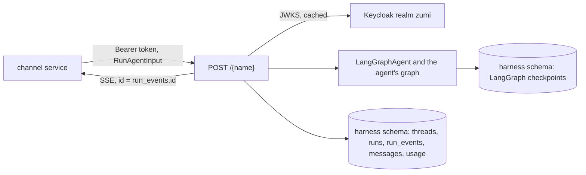

# Harness architecture

The harness serves Zumi's agents over HTTP, speaking the [AG-UI](https://docs.ag-ui.com) protocol with server-sent events, one app for every agent. A channel service in front of it, not built yet, will carry each user's desktop app, mobile app, WhatsApp or voice to it. Every request carries a Keycloak token, and the harness keeps each user's threads, runs, events, transcript and usage in Postgres. Read this page before you change how the harness is put together: its layers, agents, tools or how agents are served. Follow [the coding guidelines](../development/coding-guidelines.md) for the code itself, and [running the harness](../development/running.md) to start it.

## Layers

| Folder               | Holds                                                                                                                   |
| -------------------- | ----------------------------------------------------------------------------------------------------------------------- |
| `src/app`            | The FastAPI app, the dependency-injector `Container`, the token check in `auth.py`, and the AG-UI routes in `agui/`     |
| `src/core`           | Settings, read from `config.toml` and the environment                                                                   |
| `src/agents`         | One folder per agent: `profile.yaml`, `system.md`, optional `skills/` and `tools/`. Also the registry and `build_agent` |
| `src/clients`        | The LLM providers                                                                                                       |
| `src/infrastructure` | Logging, tracing and metrics in `observability/`, and the Postgres engine, pool, tables and queries in `persistence/`   |
| `migrations`         | The Alembic migrations that create the harness's own tables                                                             |

## Agents

An agent is a folder under `src/agents/<name>/` with:

- `profile.yaml`, the agent's own settings. `tool_description_overrides` replaces a tool's description by tool name.
- `system.md`, the system prompt.
- `skills/<skill>/SKILL.md`, optional. A skill's `metadata.include_tools` lists tools the agent is offered only after it reads that skill.
- other modules the agent's tools share.
- `tools/<tool>.py`, optional, one file per tool. A tool that needs settings is a `<tool>_tool` function that takes them and returns a `BaseTool`, built with `StructuredTool.from_function` and an `args_schema` that forbids extra arguments. The agent's container passes the settings, so a tool never reads them itself.

`config.toml` registers each agent under `[[agents]]` with its `name`, the `path` of its `profile.yaml`, and the `family` and `model` it runs on. `[models]` lists the models each family offers, and a settings error refuses an agent on a model `[models]` does not offer. `load_agents` reads every registered agent into an `Agent`, and the container keeps one registry. An `Agent`'s `model_provider` names the provider its family runs on, which its usage reports: `openai`, `anthropic` for `claude`, and `gateway` for `glm`.

`build_agent` builds an `Agent` on the chat model it is given with deepagents' `create_deep_agent`, and sets the graph's `recursion_limit` to the one it is given. The agent's filesystem is read-only and rooted at its `skills/` folder, so it can read its skills and cannot change them. It is offered the `tools` it is built with, and each `skill_tools` tool once it reads a skill that lists the tool. An agent without a `skills/` folder has no skills middleware.

`llm_provider` makes the chat model of a family: `claude` on Anthropic, `openai` on OpenAI's Responses API, both reasoning at `reasoning_effort`, and `glm` on an OpenAI-compatible gateway set by `AIGW_BASE_URL` and `AIGW_API_KEY`. It takes those settings as arguments from the container, so neither it nor `build_agent` reads the settings itself.

## Serving agents

`src/app/agui/router.py` serves every `ServedAgent(name, model_provider, open_graph)` in the container's `agents` at its own root, `/<name>`:

| Route                          | Does                                                                                                                                            |
| ------------------------------ | ----------------------------------------------------------------------------------------------------------------------------------------------- |
| `POST /<name>`                 | Takes an AG-UI `RunAgentInput` and streams the run's AG-UI events as `text/event-stream`                                                        |
| `GET /<name>/runs/<id>`        | The status of one of the caller's runs: `status`, `errorCode`, `error`, `createdAt`, `firstTokenAt`, `finishedAt`                               |
| `GET /<name>/threads/messages` | The caller's transcript with the agent, oldest first: the latest `limit` messages (default 50, at most 100), written before `before` when given |

`GET /health` reports that the server is up, with the app's version, and needs no token. `open_graph` is an async context manager that opens the agent's graph for one run, together with anything the run holds open. It closes them when the run ends, including when the run fails or the client leaves. Build the graph inside `open_graph` and ask the checkpointer's provider for the saver there. The app makes the saver when it starts, inside the running event loop, as `AsyncPostgresSaver` must be.

### Tokens

Every route but `/health` needs `Authorization: Bearer <token>`, a Keycloak access token from the `zumi` realm. `verified_claims` in `src/app/auth.py` checks it locally with PyJWT: the signature against the realm's keys, with only the algorithms in `[auth] algorithms` (`RS256`), the issuer (`[auth] issuer`), that `aud` names `zumi-harness` (`[auth] audience`), `exp` and `nbf` with `[auth] leeway_s` seconds of clock skew, that `exp`, `iss`, `aud`, `sub`, `azp` and `typ` are present, and that `typ` is `Bearer`, as on a Keycloak access token, so an ID token (`typ: ID`) is refused. The app keeps the `[auth]` settings on `app.state` with the keys, so the check never reads the settings itself. A request without a valid token gets 401 with `WWW-Authenticate: Bearer`, and 503 when the keys can't be fetched. The caller is the token's `azp`, such as `zumi-channel`, and the user is its `sub`.

PyJWT's `PyJWKClient` fetches the keys from `[auth] jwks_url`, the realm's `/protocol/openid-connect/certs`. It keeps them for five minutes, and fetches them again early for a token whose key ID it doesn't know, at most once every 30 seconds. Inside Docker the harness reaches Keycloak at `keycloak:8080`, so `docker-compose.yaml` sets `jwks_url` there while the issuer stays `http://localhost:8180/realms/zumi`.

### Threads and runs

A thread is one user's lifelong conversation with one agent through one client: a `threads` row keyed by agent, `client_id` (the token's `azp`) and `user_id` (its `sub`), made on first use. The client's `threadId` is ignored, so a client can't read or write another thread, and two agents never share one. The LangGraph `thread_id` is `threads.id`, so the checkpointer keeps the conversation under it.

`POST /<name>` builds the run's turn and records the run as `running` before it streams anything, with that turn and the user's text:

- **Only the last user message.** The turn is a new `RunAgentInput` on the thread holding only the client's last user message, under the run's id. The harness stores the turn in `runs.input` and runs it, so a client can't edit, fork or add to the thread's history, and nothing else it sent is kept. A `RunAgentInput` without a user message gets 422 before anything is recorded.
- **One run at a time per thread.** A unique index on `runs(thread_id)` where `status = 'running'` refuses a second run while one is running, across every process. The second request gets 409 with `{"message": ..., "runId": <the running run>}`.
- **A run id is used once.** A `runId` that already exists violates `runs`' primary key and gets 409 with that `runId`. Any other integrity error is raised as it is.

The run is tied to its request. When the client leaves before the run's terminal event is recorded, the run stops, what it held open closes and the run is recorded as `cancelled`.

### Events

[`ag-ui-langgraph`](https://pypi.org/project/ag-ui-langgraph/)'s `LangGraphAgent` turns the LangGraph run into AG-UI events. It gets the graph's own config, which carries `recursion_limit`, because it would otherwise run the graph at LangGraph's default of 25 steps, and `subagent_visibility="attributed"`, so a subagent's events carry its `subagentRunId`. `run_events` in `src/app/agui/events.py` then:

- drops the `MESSAGES_SNAPSHOT` and `STATE_SNAPSHOT` that would resend the whole lifelong thread every run. `RAW` events are off.
- stamps every event with `timestamp`, in milliseconds since the epoch, and `metadata.agent`: the served agent, or the subagent named by the `SUBAGENT_STARTED` event whose `subagentRunId` the event carries, such as `general-purpose`.
- records each event in `run_events`, committing each one, and only then sends it as an SSE event whose `id:` is that row's id. The run holds one database connection for its whole stream. FastAPI's `EventSourceResponse` writes the SSE and sends a `: ping` comment every 15 seconds the run is quiet.
- records the terminal event, `RUN_FINISHED` or `RUN_ERROR`, in one transaction with the run's end: the `runs` row's status, error and times, the agent's answer in `messages`, and the rows of `run_model_usage` and `run_tool_usage`. `finish_run` updates the run only while its status is `running`, and records nothing more when it already ended. The run counts as ended only once that transaction commits.

A run starts with `RUN_STARTED`, streams `TEXT_MESSAGE_*` as the model writes and `TOOL_CALL_*` for each tool call and its result, and ends with exactly one `RUN_FINISHED` or `RUN_ERROR`. A tool that returns an error message to the model is its result, and the run goes on.

`RUN_FINISHED` and `RUN_ERROR` carry the run's `usage` as `LangGraphAgent` sets it: AG-UI `TokenUsage` entries, one per provider and model, from each model call's LangChain `usage_metadata`, named by LangChain's `ls_provider` and `ls_model_name`. When a run ends through an exception instead, such as a graph that fails to open, its `RUN_ERROR` may have no `usage`. Their `metadata` adds:

| Key                  | Holds                                                                                                                               |
| -------------------- | ----------------------------------------------------------------------------------------------------------------------------------- |
| `agentUsage`         | Tokens by agent, provider and model: `inputTokens`, `outputTokens`, `reasoningTokens`, `cachedInputTokens`, `cacheWriteInputTokens` |
| `toolUsage`          | Calls by agent, tool and provider: `calls`, `failures`, `durationMs`                                                                |
| `durationMs`         | Time from the run's start to its end                                                                                                |
| `timeToFirstTokenMs` | Time from the run's start to its first `TEXT_MESSAGE_CONTENT`, or null when it wrote no text                                        |

`RunUsage` in `src/app/agui/usage.py` counts them. It is a LangChain callback handler added to the run's config, so it sees every model and tool call, a subagent's included, and names the agent from LangChain's `lc_agent_name`. A model call's `provider` is the served agent's `model_provider`, so a `glm` model reports `gateway`, not the `openai` LangChain's `ls_provider` gives every OpenAI-compatible client, and its `model` is LangChain's `ls_model_name`. A tool call fails when it raises or returns an error to the model. A tool that reports which service answered returns the service's name as its `ToolMessage` artifact, and it becomes the call's `provider`.

### Errors

`RUN_ERROR` has a fixed `code`, a `RunErrorCode`:

| Code              | When                                                                                                                                             |
| ----------------- | ------------------------------------------------------------------------------------------------------------------------------------------------ |
| `recursion_limit` | The run went past `recursion_limit` steps                                                                                                        |
| `timeout`         | The error that ended the run, or its cause, is a `TimeoutError` or an `httpx` timeout                                                            |
| `tool_error`      | A tool raised, opening the graph or what the run holds open failed, or one of those crashed mid-run                                              |
| `model_error`     | The model's provider failed, including building its client while opening the graph, such as a missing API key, or anything else the graph raised |
| `storage_error`   | Recording one of the run's events in Postgres failed                                                                                             |

`LangGraphAgent` catches what the graph raises and ends the run with `RUN_ERROR` itself; `RunUsage` keeps the error so the harness can give its code. When opening the graph fails, or something the run holds open crashes mid-run, `_agent_events` catches it with `except*`, because task groups wrap it in exception groups. It reports the innermost error, after a `RUN_STARTED` when the run hadn't started, so every run has exactly one start and one end. A failure after the run's terminal event is logged with its traceback, not sent.

When recording an event fails, the run stops, and the harness records and sends a `RUN_ERROR` with code `storage_error` and the database's message, on a new connection, so the run ends as `error`, not `cancelled`. The event that failed is never sent, so the events a client got are always the ones recorded.

### What Postgres keeps

The harness's tables live in the `harness` schema (`[database] schema_name`) of the Postgres the root `docker-compose.yaml` runs, created by the Alembic migrations in `migrations/` (see [running the harness](../development/running.md)). `src/infrastructure/persistence/tables.py` defines them with SQLAlchemy Core:

| Table             | Holds                                                                                                                              |
| ----------------- | ---------------------------------------------------------------------------------------------------------------------------------- |
| `threads`         | One row per agent, client and user                                                                                                 |
| `runs`            | Each run: its thread, `status`, `error_code`, `error`, the turn it ran as `input`, and when it started, first wrote text and ended |
| `run_events`      | Every event a run sent, in order, with the agent that produced it                                                                  |
| `messages`        | The transcript: each run's user text and, when it finished, the agent's final text                                                 |
| `run_model_usage` | Each run's tokens by agent, provider and model; `model` is null when the chat model doesn't name it                                |
| `run_tool_usage`  | Each run's tool calls, failures and time by agent, tool and provider; `provider` is null for a tool that reports none              |

`run_events`, `messages`, `run_model_usage` and `run_tool_usage` are deleted with their run (`ON DELETE CASCADE`). The usage tables' unique constraints treat nulls as equal (`NULLS NOT DISTINCT`), so a run has one row per agent and model, and per agent, tool and provider, even when `model` or `provider` is null. Every other usage column is `NOT NULL`.

`status` is a `RunStatus` and `error_code` a `RunErrorCode`, both Python `StrEnum`s stored as text: `running`, then `finished` (`RUN_FINISHED`), `error` (`RUN_ERROR`) or `cancelled` (the client left before the run's terminal event).

LangGraph's `AsyncPostgresSaver` keeps the checkpoints in the same schema, through a psycopg pool whose connections set `search_path` to it. The app opens the pool when it starts and creates LangGraph's tables, one process at a time under an advisory lock. The pool checks each connection before lending it, so a Postgres restart doesn't fail the next runs. The SQLAlchemy engine on the harness's own tables doesn't check connections before use: after a Postgres restart, the first query on a stale connection fails, and SQLAlchemy then drops every connection the engine held before it.

A long conversation is summarised by deepagents' summarisation middleware, which offloads the turns it summarises away to `/conversation_history/`. `build_agent` routes that path to the thread's own state, so the offloaded turns are checkpointed with the thread and never written to the agent's folder.

### The container

`Container` wires the settings, the agent registry, the engine on the harness's tables, the checkpointer's pool and saver, the realm's keys and the `agents` list. It is the only place that reads the settings: `create_app` puts the engine, the keys, the `[auth]` settings and the agents on `app.state`, and each agent's container passes the settings its model, tools and graph need. To serve a new agent, add `src/app/container/<agent>.py` with a `<Agent>Container` that takes the settings, the registry and the checkpointer as dependencies and provides the agent's `ServedAgent`, with its `model_provider` from the registry, and a `model` factory on `llm_provider`. Wire it in `Container` with `providers.Container`, and add its `served` to `agents`.

## Observability

`src/infrastructure/observability` follows renderverse's ezcareer-harness. `configure_logging` sends structlog and standard library logs, uvicorn's included, to stderr, as JSON lines or console text (`[observability] log_format`), each with the service and environment, cutting any field longer than 1000 characters. With `tracing_enabled` and `metrics_enabled`, traces and metrics go over OTLP HTTP to `otlp_endpoint`, which is the collector in Docker, and `instrumentations = ["langchain"]` traces every LangChain and LangGraph run through OpenInference, hiding what `[observability.trace_redaction]` says. The app flushes traces and metrics when it stops.

## Settings

`config.toml` holds every URL, limit and model name. Environment variables with the `ZUMI_HARNESS_` prefix override it, and `__` separates nested names, such as `ZUMI_HARNESS_APP__PORT` or `ZUMI_HARNESS_DATABASE__URL`. Secrets live only in `.env`, which git ignores. `.env.example` lists them.
