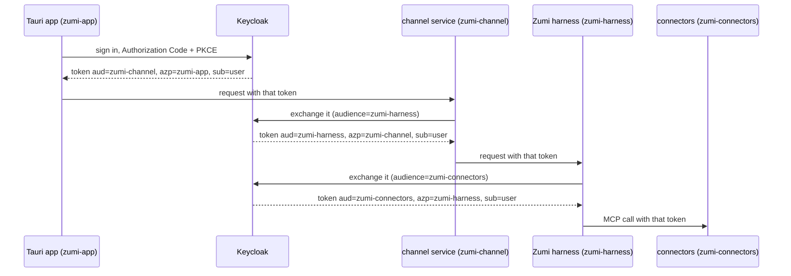

# Keycloak

Keycloak signs Zumi's users in and issues the tokens every service checks. It runs from the root `docker-compose.yaml` and imports the `zumi` realm from `realm/zumi-realm.json` on its first start.

## Running

From the repository root:

```bash
pnpm exec nx run keycloak:up
```

```bash
pnpm exec nx run keycloak:verify
```

- `up` starts Postgres and Keycloak and waits until Keycloak is ready. Keycloak listens on `http://localhost:8180`, set by `KEYCLOAK_HOST_PORT`, and keeps its tables in Postgres's `keycloak` schema, which `infra/postgres/init/01-schemas.sql` creates when the Postgres volume is first made.
- `verify` runs `verify.py` against the running Keycloak. It creates a throwaway user, signs in as `zumi-app` through the real login page with PKCE, exchanges the token as `zumi-channel` and then as `zumi-harness`, gets a `zumi-channel` service-account token, checks every token's audience, caller and user, and deletes the user.
- The admin console is at `http://localhost:8180/admin`, with `KEYCLOAK_ADMIN_USERNAME` and `KEYCLOAK_ADMIN_PASSWORD` from `.env`.

`.env.example` holds local development values for the admin login and the client secrets. Set real ones anywhere else.

## The realm

`zumi` allows sign-up with an email as the username, password reset and remember-me. Access tokens last 5 minutes. Offline sessions, for apps that stay signed in, last 30 days idle.

| Client            | Kind                                     | Used by                    | Can                                                           |
| ----------------- | ---------------------------------------- | -------------------------- | ------------------------------------------------------------- |
| `zumi-app`        | public, Authorization Code + PKCE (S256) | the Tauri and mobile apps  | sign the user in; its tokens are for `zumi-channel`           |
| `zumi-channel`    | confidential, service account            | the channel service        | exchange a user's app token for one for `zumi-harness`        |
| `zumi-harness`    | confidential, service account            | the Zumi harness           | exchange a user's harness token for one for `zumi-connectors` |
| `zumi-connectors` | audience only                            | the connectors MCP service | nothing; tokens are issued for it                             |

- **Redirects.** `zumi-app` redirects to `zumi://auth/callback` (the app's deep link) or `http://127.0.0.1/callback` on any port (a native app's loopback listener, as RFC 8252 allows). It allows no browser origins.
- **Audiences.** Each audience comes from a client scope holding an audience mapper: `zumi-channel-audience` on `zumi-app`, `zumi-harness-audience` on `zumi-channel`, and `zumi-connectors-audience` on `zumi-harness`. Keycloak's standard token exchange only issues audiences the requesting client's scopes grant, so the channel service can't get a connectors token.
- **User claims.** The user profile adds `zoneinfo` (an IANA time zone) and `country` (ISO 3166-1 alpha-2) next to the built-in `locale`. The `profile` and `address` scopes put them in tokens as the standard OIDC claims `zoneinfo`, `locale` and `address.country`.
- **Token exchange.** `zumi-channel` and `zumi-harness` have "Standard token exchange" on (`standard.token.exchange.enabled`). An exchanged token keeps the user as `sub` and names the exchanging client as `azp`, and it expires with the token it came from.



Every service checks tokens itself, against Keycloak's JWKS at `http://localhost:8180/realms/zumi/protocol/openid-connect/certs`, cached and fetched again only for an unknown key ID. The issuer is always `http://localhost:8180/realms/zumi` (`KEYCLOAK_URL`), including for services that reach Keycloak inside the Docker network.

## Changing the realm

Keycloak imports `realm/zumi-realm.json` only when the realm doesn't exist yet, and ignores it after that. To change the realm:

1. Make the change in the admin console.
2. Export it: `Realm settings` → `Action` → `Partial export`, with clients, groups and roles.
3. Replace each confidential client's masked secret with its `${KEYCLOAK_..._CLIENT_SECRET}` placeholder, drop the `org.keycloak.keys.KeyProvider` components so each environment generates its own keys, and save it over `realm/zumi-realm.json`.
4. Check the file from scratch: drop and recreate the `keycloak` schema, run `up`, then `verify`.
